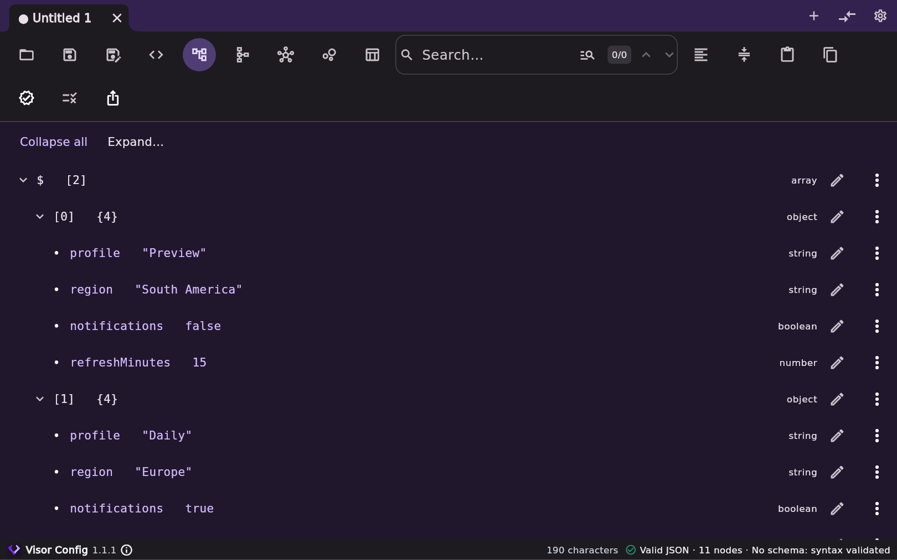
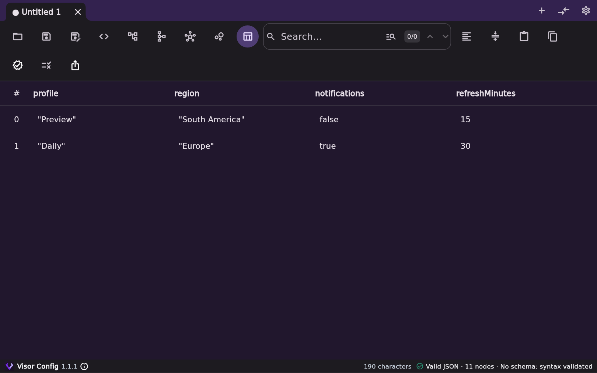
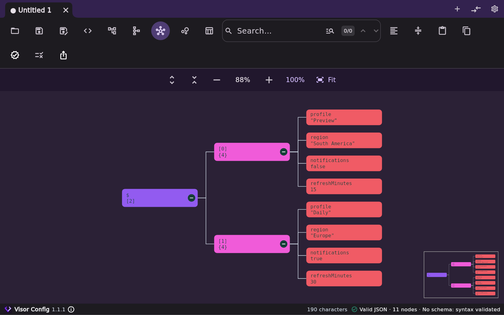

# Visor Config

[English](README.md) · [Español](README.es.md) · [Português](README.pt.md) · [Deutsch](README.de.md) · [Italiano](README.it.md)

[Versions et téléchargements](RELEASES.md)

Visor Config est une application multiplateforme simple pour visualiser, modifier, valider et comparer des fichiers de configuration dans plusieurs formats. Elle propose la coloration syntaxique et l’exportation dans plusieurs formats.

## Fichiers et onglets

- **Formats** — JSON, JSONC, YAML (`.yaml`, `.yml`), TOML, INI (`.ini`, `.cfg`), dotenv (`.env`, `.env.local`) et Java Properties (`.properties`).
- **Onglets** — Ouvrez plusieurs fichiers dans des onglets distincts. Chaque onglet conserve son format et son schéma.
- **Comparaison** - Comparez deux onglets côte à côte, avec mise en évidence des différences et navigation entre elles.

## Vues et modification

| Vue | Utilisation |
| --- | --- |
| Texte | Modifiez le fichier avec la coloration syntaxique et les numéros de ligne. Formatez ou minifiez le document. |
| Arbre | Dépliez les sections, modifiez les valeurs et copiez les valeurs ou les chemins. |
| Graphe / Radial | Explorez la structure du document. Dépliez les branches, déplacez-vous et zoomez. |
| Tableau | Consultez et modifiez les lignes d’une liste d’objets qui ont les mêmes champs. |

Effectuez une recherche dans le document actif par texte ou par JSONPath. La barre d’état affiche les erreurs de syntaxe. Pour les fichiers JSON, utilisez l’option de schéma pour valider le document avec un JSON Schema. Pour comparer deux versions, ouvrez les fichiers dans des onglets distincts et lancez la comparaison JSON. Les changements sont mis en évidence côte à côte.

## Exportation

- Convertissez les données en JSON, YAML, TOML, INI, dotenv ou Java Properties lorsque le format cible accepte leur structure.
- Exportez les données tabulaires en CSV. Par exemple, ouvrez une liste de profils qui ont les mêmes champs, passez à la vue **Tableau**, puis choisissez CSV dans le menu d’exportation.
- Exportez le graphe visible en PNG ou SVG. Dépliez les branches à inclure avant l’exportation.

## Apparence

L’apparence suit le thème du système et peut aussi être réglée sur clair ou sombre. Vous pouvez choisir la palette de couleurs, la police et sa taille.

[Licence GPL 3](LICENSE)
